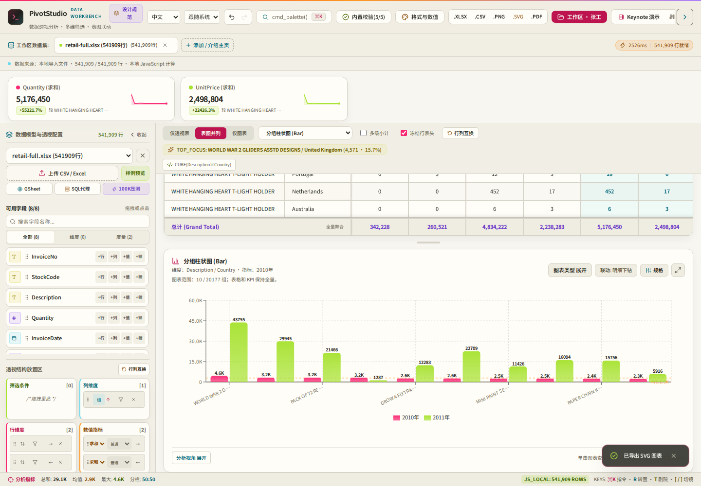
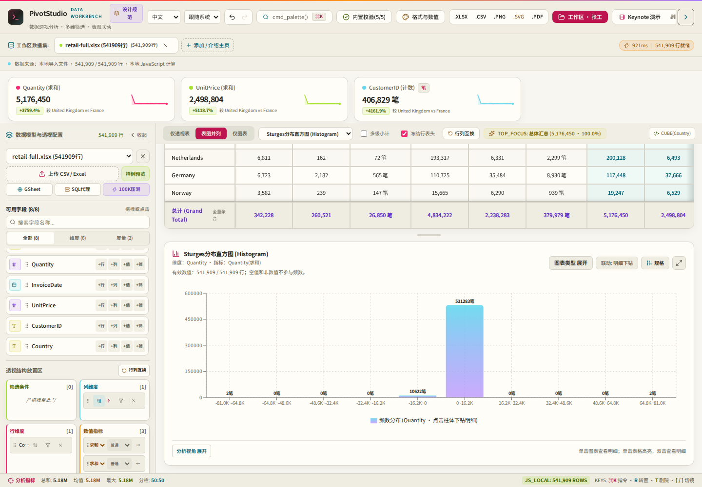

# Full workbook and chart boundary loop · 2026-10-22

This round continues the prior release with the previously untested complete UCI workbook and cross-timezone imports. It preserves React/Vite/Recharts, existing configurations, raw aggregation and browser-local data processing. No dependency was added.

## Evidence and priority

| Priority | Reproduction and evidence | Root repair |
| --- | --- | --- |
| P1 | Import all 541,909 Online Retail records, accept default Description/Country grouping. The resulting 20,177 chart groups blocked the main thread for 33.49s. | More than 200 category groups now require an explicit filter, fewer dimensions or TopN before SVG rendering. A one-click Top 10 action is available. Full table, KPI and status-bar aggregates remain available. No silent chart truncation. |
| P0 | On a 1,000-row numerical dataset, histogram frequencies summed to only 50. It counted the raw-record preview sample as the whole population. | Histograms count every valid filtered numeric record in the Worker. Blank, invalid and non-finite values are excluded and the valid/filtered denominator is shown. Final upper bounds are inclusive. |
| P1 | A histogram bin could claim hundreds of matches but drill down only its first 50 samples. | Bin boundaries stay in the Worker cache; clicking a bin requests all matching original rows by current result generation. Existing 50-row detail pagination remains. Raw samples are removed from chart messages. |
| P2 | Explicit TopN was ignored or reordered in heatmaps; columns-only cells used a grand-row key as their drilldown column. | Heatmap cells follow the selected Chart Spec keys/order in both orientations. Column-specific drilldown and linked filtering use the correct column key. |
| P2 | Activating the new TopN action by keyboard removed the focused button. | Restore focus to the existing chart-type control only if focus has fallen to the document body; preserve a user's intervening focus move. |

Chart bounds do not change any underlying table filter, sort or aggregate. When the user chooses TopN, the UI and exported SVG/PNG identify the displayed group scope. Attempting chart export before choosing a safe scope returns an actionable error. No export of a blank or previous plot is reported as success.

## Real workbook oracle and before/after

Source: [Chen, Online Retail, UCI](https://archive.ics.uci.edu/dataset/352/online+retail), attributed under the source CC BY 4.0 license. The unchanged XLSX is extracted from the same published archive as the prior subset test. This time **all 541,909 rows** are imported. [Archive/workbook hashes and streaming Python oracle](quality-evidence/full-workbook-oracle.json) include country and quantity-frequency aggregates; no source transactions are committed.

| Check | Independent expectation | Executed result |
| --- | --- | --- |
| Total Quantity | 5,176,450 | Full default XLSX export agrees |
| Country groups | 38 | Every country Quantity agrees with Python/openpyxl |
| Missing Description / CustomerID | 1,454 / 135,080 | Oracle records these gaps; COUNT(CustomerID) export is 406,829 |
| Histogram frequency total | 541,909 | All bins agree with the independent Quantity frequency counter |
| Largest histogram bin | 531,283 | Actual browser drilldown returns 531,283 records, with 50 visible per page |
| Timezone/calendar | Original wall-clock date | UTC / Asia-Shanghai / America-New-York × 1900 / 1904 systems all retain 2026-03-08 00:30 and its day grouping |

Same Chromium executable, viewport 1440×1000, Asia/Shanghai timezone, same workbook hashes, isolated browser runs:

| Measurement | Before | After |
| --- | ---: | ---: |
| Preview | 34,025ms | 28,678ms |
| Confirm → complete current pivot | 44,494ms | 8,269ms |
| Largest 20ms main-thread timer gap | 33,491.9ms | 854.9ms |

[Raw before metrics](quality-evidence/full-workbook-before.json) · [Raw after metrics and functional checks](quality-evidence/full-workbook-after.json)

The repair targets chart rendering and message size; it does not speed up XLSX parsing. Preview variation is not presented as a parser improvement. These are bounded single-machine observations, not a universal latency guarantee. There is still a substantial workbook parse wait and a roughly 0.85s transfer/render gap. Full workbooks can require over a gigabyte of browser memory.

Optional Noto Sans SC fonts are applied **after** performance measurement for readable current-state screenshots. Initial font-missing captures are diagnostic only, not visual quality or pixel-diff baselines.





## Executed regression and accessibility

- 39 Node tests passed, including full histogram population, invalid/zero/constant/extreme values, disjoint bin membership, full KPI/status totals when chart rendering is bounded, raw-sample-free Worker messages and complete Worker bin drilldown.
- The prior complete Chromium run passed 30 tests. Subsequent focused regressions cover keyboard focus, selected axe rules on four new blocked/TopN states at 360/1440px, and columns-only heatmap sorting/drilldown/filtering. Final branch CI records the complete current suite separately.
- Existing suite covers R1–R8, representative 360/768/1280/1440px states, keyboard/modal focus, mobile controls and original chart smoke. The six timezone/calendar combinations run in the browser, not as a date-string-only unit assertion.
- Actual full-workbook browser checks passed preview, complete table export, explicit scoped chart/SVG export, every country aggregate, non-empty CustomerID count, every histogram bin and complete largest-bin drilldown. No page exceptions or non-GET requests were observed. Synthetic 250/1,000/2,000-row fixtures are explicitly regression fixtures, not business-data evidence.

Discarded or failed checks remain documented: the first exploratory harness checked the root's old `idle` state while normalization was still active and gave an invalid 980ms completion measurement. It was replaced with preview-closure, current row-status and current calculation completion checks before recording the baseline above. An initial plot selector counted Lucide icon SVGs and was narrowed to chart SVGs. A footer assertion initially observed intentional cell-hover telemetry; the pointer is now moved off the table before asserting summary totals. Keyboard focus and heatmap descending-order regressions failed before their repairs. No failed run is called a pass.

## Reproduction and files

```bash
python scripts/prepare-full-retail.py
CHROME_BIN=/path/to/chrome node scripts/full-workbook-audit.mjs
DELIVERY_URL=https://lovemoganna.github.io/PivotStudio/ CHROME_BIN=/path/to/chrome node scripts/full-workbook-audit.mjs
```

The preparation script uses the existing optional Python/openpyxl validation environment. The app dependencies are unchanged. For a controlled baseline, create a worktree at `63b1e25`, supply its dependencies and run the current harness with `AUDIT_ROOT=/absolute/baseline MEASURE_ONLY=1 AUDIT_PHASE=before`. This records readiness/timer metrics without expecting new UI controls. `AUDIT_FONT_DIR` optionally supplies locally installed `@fontsource/noto-sans-sc` assets. Online tests can use the existing HTTPS-proxy test flags where required; certificate ignoring defaults off.

Changed application files: `src/features/pivot/engine/{histogram,buildChartSpec,pivotWorker}.js`, `src/features/pivot/{PivotWorkbench.jsx,components/ChartStudio.jsx}`, `src/utils/exportUtils.js`, `src/i18n.js`. Added tests: `tests/histogram.test.js`, `tests/browser/chart-boundaries.spec.js`; added validation scripts and this report/evidence.

## Remaining limits and stop condition

Physical Safari/Edge/iPhone/Android, private user files, low-memory phones and arbitrary large-column/large-series layouts are unverified. WebKit CI and touch/viewport emulation are narrower checks. The workbook is not uploaded by the app; raw rows remain browser-local. OS process termination cannot be guaranteed recoverable. This run closes the demonstrated high-cardinality chart stall and incorrect histogram population/drilldown, plus regressions found during reverse checks. It stops after current-suite CI and actual production replay, without unrelated restyling or additional speculative changes. Final CI/deployment outcomes are recorded in the PR release record.
